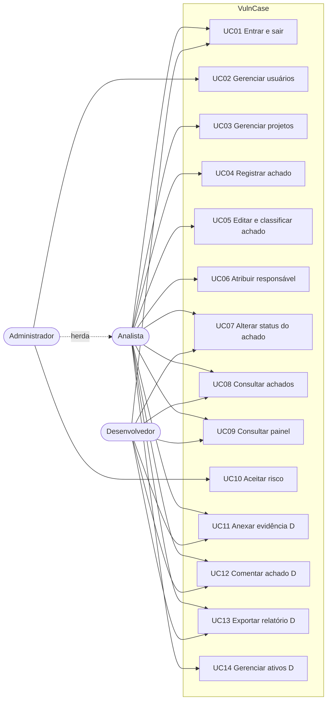
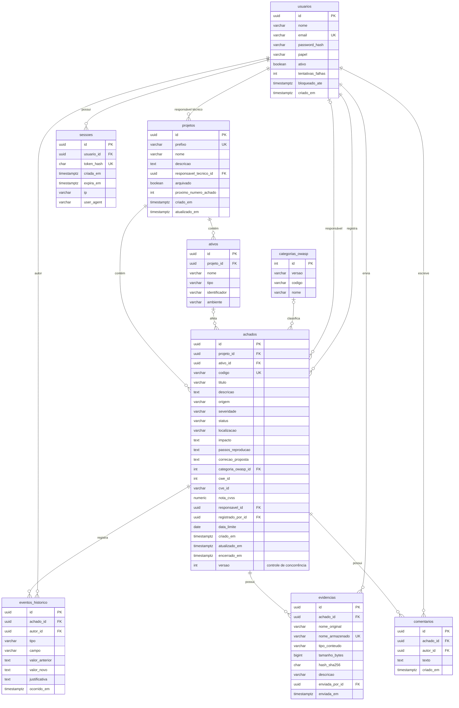
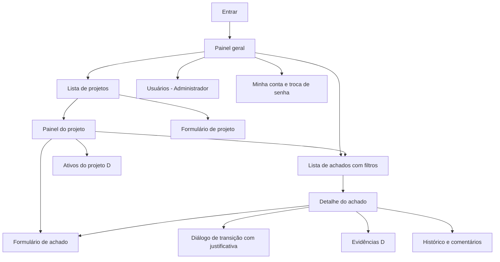
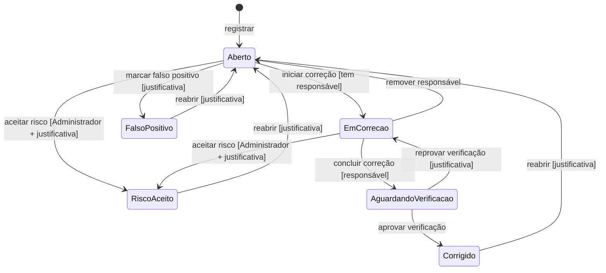

# 03 — Modelagem

Os diagramas usam Mermaid e são renderizados diretamente no GitHub e no GitLab.

## 1. Casos de uso

A Figura 1 apresenta os casos de uso por ator. Os casos marcados com (D) pertencem ao escopo desejável.



*Figura 1 — Diagrama de casos de uso.*

### 1.1 Descrição dos casos de uso principais

**UC04 — Registrar achado**

| Item | Descrição |
|---|---|
| Ator | Analista |
| Pré-condição | Usuário autenticado com papel Analista ou Administrador; projeto não arquivado. |
| Fluxo principal | 1. O analista abre o projeto e aciona "Novo achado". 2. Preenche título, descrição, origem, severidade, localização, impacto, passos de reprodução, correção proposta e, opcionalmente, categoria OWASP, CWE e responsável. 3. O sistema valida os campos. 4. O sistema gera o código do achado (RN02), grava o achado com status "Aberto" e registra o evento de criação no histórico. 5. O sistema exibe o detalhe do achado. |
| Fluxo alternativo | 3a. Campo inválido: o sistema indica os campos com erro e mantém os dados digitados. |
| Exceção | Projeto arquivado: o sistema recusa o registro (HTTP 409). |
| Pós-condição | Achado com status "Aberto" e evento de criação no histórico. |
| Requisitos | RF12, RF13, RF14, RF20, RN01, RN02 |

**UC07 — Alterar status do achado**

| Item | Descrição |
|---|---|
| Atores | Analista, Desenvolvedor, Administrador |
| Pré-condição | Usuário autenticado; transição permitida ao papel e ao estado atual (seção 6). |
| Fluxo principal | 1. O usuário abre o achado; o sistema exibe apenas as transições permitidas a ele. 2. O usuário escolhe a transição e, quando exigido, informa justificativa. 3. O sistema valida a transição no back-end. 4. O sistema atualiza o status, a data de encerramento quando aplicável e grava o evento no histórico. |
| Fluxo alternativo | 2a. Transição exige justificativa e o campo está vazio: o sistema recusa e solicita a justificativa. |
| Exceções | Transição não permitida ao papel: HTTP 403. Transição inexistente a partir do estado atual: HTTP 409. Achado alterado por outro usuário desde a leitura: HTTP 409 com pedido de recarga. |
| Pós-condição | Novo status e evento de transição no histórico. |
| Requisitos | RF16, RF17, RF20, RN03 a RN06 |

**UC06 — Atribuir responsável**

| Item | Descrição |
|---|---|
| Ator | Analista |
| Pré-condição | Achado não encerrado. |
| Fluxo principal | 1. O analista escolhe um usuário ativo na lista de responsáveis. 2. O sistema grava o responsável e registra o evento no histórico com o valor anterior e o novo. |
| Fluxo alternativo | 1a. O analista remove o responsável: se o achado estiver "Em correção", o sistema o devolve a "Aberto" e registra as duas alterações. |
| Requisitos | RF15, RF20, RN03 |

**UC09 — Consultar painel**

| Item | Descrição |
|---|---|
| Atores | Todos |
| Fluxo principal | 1. O usuário abre o painel geral ou o painel de um projeto. 2. O sistema exibe: total por severidade e status, achados abertos sem responsável, achados vencidos e os dez achados abertos mais graves, ordenados por severidade e data de registro. 3. Ao clicar em um indicador, o sistema abre a listagem de achados com o filtro correspondente. |
| Requisitos | RF27, RF28, RN09 |

## 2. Modelo de domínio

A Figura 2 apresenta as entidades e seus relacionamentos. As classes `Ativo`, `Evidencia` e `Comentario` pertencem ao escopo desejável.

```mermaid
classDiagram
    direction LR

    class Usuario {
        UUID Id
        string Nome
        string Email
        Papel Papel
        boolean Ativo
    }

    class Projeto {
        UUID Id
        string Prefixo
        string Nome
        string Descricao
        boolean Arquivado
        number ProximoNumeroAchado
        GerarCodigoAchado() string
    }

    class Ativo {
        UUID Id
        string Nome
        TipoAtivo Tipo
        string Identificador
        Ambiente Ambiente
    }

    class Achado {
        UUID Id
        string Codigo
        string Titulo
        string Descricao
        OrigemAchado Origem
        Severidade Severidade
        StatusAchado Status
        string Localizacao
        string Impacto
        string PassosReproducao
        string CorrecaoProposta
        number CweId
        string CveId
        number NotaCvss
        Date DataLimite
        Date EncerradoEm
        AtribuirResponsavel(Usuario, Usuario autor)
        Transicionar(StatusAchado destino, Usuario autor, string justificativa)
        EstaVencido(Date hoje) bool
    }

    class CategoriaOwasp {
        number Id
        string Versao
        string Codigo
        string Nome
    }

    class EventoHistorico {
        UUID Id
        TipoEvento Tipo
        string Campo
        string ValorAnterior
        string ValorNovo
        string Justificativa
        Date OcorridoEm
    }

    class Evidencia {
        UUID Id
        string NomeOriginal
        string NomeArmazenado
        string TipoConteudo
        number TamanhoBytes
        string HashSha256
        string Descricao
    }

    class Comentario {
        UUID Id
        string Texto
        Date CriadoEm
    }

    Projeto "1" *-- "0..*" Achado : contém
    Projeto "1" *-- "0..*" Ativo : contém
    Projeto "0..*" --> "1" Usuario : responsável técnico
    Achado "0..*" --> "0..1" Ativo : afeta
    Achado "0..*" --> "0..1" Usuario : responsável
    Achado "0..*" --> "1" Usuario : registrado por
    Achado "0..*" --> "0..1" CategoriaOwasp : classificado em
    Achado "1" *-- "0..*" EventoHistorico : histórico
    Achado "1" *-- "0..*" Evidencia : evidências
    Achado "1" *-- "0..*" Comentario : comentários
    EventoHistorico "0..*" --> "1" Usuario : autor
    Evidencia "0..*" --> "1" Usuario : enviada por
    Comentario "0..*" --> "1" Usuario : autor
```



*Figura 2 — Modelo de domínio.*

As regras de transição de status e de atribuição ficam em funções puras do módulo de domínio (`transicionar` e `atribuirResponsavel`). Essa decisão concentra as regras de negócio em um único ponto, testável sem banco de dados e sem HTTP. Os *handlers* das rotas apenas carregam a entidade, chamam o método e persistem o resultado.

### 2.1 Enumerações

**Tabela 1 — Enumerações do domínio**

| Enumeração | Valores |
|---|---|
| `Papel` | `Administrador`, `Analista`, `Desenvolvedor` |
| `Severidade` | `Critica`, `Alta`, `Media`, `Baixa`, `Informativa` |
| `StatusAchado` | `Aberto`, `EmCorrecao`, `AguardandoVerificacao`, `Corrigido`, `FalsoPositivo`, `RiscoAceito` |
| `OrigemAchado` | `AnaliseRede`, `TesteAplicacaoWeb`, `TesteAplicacaoMovel`, `RevisaoCodigo`, `AnaliseConfiguracao`, `Outra` |
| `TipoEvento` | `Criacao`, `EdicaoCampo`, `TrocaResponsavel`, `Transicao`, `EvidenciaAdicionada`, `EvidenciaRemovida`, `Comentario` |
| `TipoAtivo` (D) | `AplicacaoWeb`, `Api`, `AplicativoMovel`, `Servidor`, `ServicoRede`, `RepositorioCodigo`, `Outro` |
| `Ambiente` (D) | `Desenvolvimento`, `Homologacao`, `Producao`, `Laboratorio` |

As enumerações são declaradas como uniões de literais em TypeScript e gravadas no banco como texto, o que facilita a leitura direta das tabelas e evita erros quando a ordem dos valores muda.

## 3. Modelo de dados

A Figura 3 apresenta o modelo físico em PostgreSQL. As tabelas são declaradas em TypeScript com Drizzle ORM, e as *migrations* são geradas a partir dessas declarações.



*Figura 3 — Modelo entidade-relacionamento.*

### 3.1 Dicionário de dados

**Tabela 2 — `projetos`**

| Coluna | Tipo | Nulo | Restrição | Descrição |
|---|---|:-:|---|---|
| `id` | `uuid` | não | PK | Identificador. |
| `prefixo` | `varchar(5)` | não | único; `^[A-Z]{2,5}$` | Prefixo do código dos achados (RN02). Imutável após o primeiro achado. |
| `nome` | `varchar(120)` | não | | Nome do projeto. |
| `descricao` | `text` | sim | até 4.000 caracteres | Escopo e contexto da análise. |
| `responsavel_tecnico_id` | `uuid` | não | FK `usuarios` | Usuário de referência do projeto. |
| `arquivado` | `boolean` | não | padrão `false` | RF09, RN08. |
| `proximo_numero_achado` | `int` | não | padrão `1` | Contador usado na geração do código. Incrementado na mesma transação do registro do achado. |
| `criado_em`, `atualizado_em` | `timestamptz` | não | | Datas em UTC. |

**Tabela 3 — `achados`**

| Coluna | Tipo | Nulo | Restrição | Descrição |
|---|---|:-:|---|---|
| `id` | `uuid` | não | PK | Identificador interno. |
| `projeto_id` | `uuid` | não | FK `projetos` | RN01. |
| `ativo_id` | `uuid` | sim | FK `ativos`; mesmo projeto | (D) Ativo afetado. |
| `codigo` | `varchar(10)` | não | único | Ex.: `WEB-0007`. |
| `titulo` | `varchar(160)` | não | | Resumo do achado. |
| `descricao` | `text` | não | até 10.000 caracteres | Descrição técnica. |
| `origem` | `varchar(30)` | não | valor de `OrigemAchado` | Tipo de análise que gerou o achado. |
| `severidade` | `varchar(15)` | não | valor de `Severidade` | Tabela 2 do documento 02. |
| `status` | `varchar(25)` | não | valor de `StatusAchado`; padrão `Aberto` | Seção 6. |
| `localizacao` | `varchar(500)` | não | | URL, rota, arquivo e linha, ou host e porta. |
| `impacto` | `text` | sim | até 4.000 caracteres | Consequência da exploração. |
| `passos_reproducao` | `text` | sim | até 10.000 caracteres | Procedimento para reproduzir. |
| `correcao_proposta` | `text` | não | até 10.000 caracteres | Recomendação de remediação. |
| `categoria_owasp_id` | `int` | sim | FK `categorias_owasp` | RF14. |
| `cwe_id` | `int` | sim | > 0 | Número CWE sem prefixo (ex.: `79`). |
| `cve_id` | `varchar(20)` | sim | `^CVE-\d{4}-\d{4,}$` | (D) RF23. |
| `nota_cvss` | `numeric(3,1)` | sim | 0,0 a 10,0 | (D) Informada manualmente. |
| `responsavel_id` | `uuid` | sim | FK `usuarios`; usuário ativo | RF15. |
| `registrado_por_id` | `uuid` | não | FK `usuarios` | Autor do registro. |
| `data_limite` | `date` | sim | | RN09, RN10. |
| `criado_em`, `atualizado_em` | `timestamptz` | não | | Datas em UTC. |
| `encerrado_em` | `timestamptz` | sim | | RN06. |
| `versao` | `int` | não | padrão `1` | Incrementada a cada alteração; usada na concorrência otimista. |

**Tabela 4 — `sessoes`**

| Coluna | Tipo | Nulo | Descrição |
|---|---|:-:|---|
| `id` | `uuid` | não | Identificador. |
| `usuario_id` | `uuid` | não | Dono da sessão. |
| `token_hash` | `char(64)` | não | SHA-256 do *token* enviado no *cookie*. O *token* em claro nunca é gravado. |
| `criada_em` | `timestamptz` | não | Momento da entrada. |
| `expira_em` | `timestamptz` | não | `criada_em` + 8 horas (RNF04). |
| `ip`, `user_agent` | `varchar` | sim | Registro para auditoria. |

Na entrada, a API gera o *token* com `crypto.randomBytes(32)`, grava o *hash* e envia o *token* no *cookie*. Em cada requisição, a API calcula o *hash* do *cookie* recebido e busca a sessão não expirada. A saída apaga a linha; a troca de senha e a desativação apagam todas as sessões do usuário.

**Tabela 5 — `eventos_historico`**

| Coluna | Tipo | Nulo | Descrição |
|---|---|:-:|---|
| `id` | `uuid` | não | Identificador. |
| `achado_id` | `uuid` | não | Achado afetado. |
| `autor_id` | `uuid` | não | Usuário que executou a ação. |
| `tipo` | `varchar(30)` | não | Valor de `TipoEvento`. |
| `campo` | `varchar(50)` | sim | Nome do campo alterado, em eventos `EdicaoCampo`. |
| `valor_anterior`, `valor_novo` | `text` | sim | Valores antes e depois da alteração. |
| `justificativa` | `text` | sim | Obrigatória nas transições da RF17. |
| `ocorrido_em` | `timestamptz` | não | Data em UTC. |

A tabela `eventos_historico` só recebe inserções. A aplicação não expõe operação de alteração ou exclusão sobre ela.

**Tabela 6 — `evidencias` (D)**

| Coluna | Tipo | Nulo | Descrição |
|---|---|:-:|---|
| `nome_original` | `varchar(255)` | não | Nome enviado pelo usuário, usado apenas para exibição e no cabeçalho de *download*. |
| `nome_armazenado` | `varchar(64)` | não | Nome gerado pelo servidor (UUID), sem extensão fornecida pelo usuário. |
| `tipo_conteudo` | `varchar(100)` | não | Tipo MIME determinado pelo servidor a partir da assinatura do arquivo. |
| `tamanho_bytes` | `bigint` | não | Até 5.242.880. |
| `hash_sha256` | `char(64)` | não | Integridade da evidência. |

### 3.2 Índices

| Tabela | Índice | Uso |
|---|---|---|
| `achados` | (`projeto_id`, `status`, `severidade`) | Listagem filtrada e painel por projeto. |
| `achados` | (`responsavel_id`, `status`) | "Meus achados" do desenvolvedor. |
| `achados` | (`data_limite`) parcial onde `encerrado_em is null` | Consulta de vencidos. |
| `eventos_historico` | (`achado_id`, `ocorrido_em`) | Exibição do histórico. |
| `usuarios` | único (`email` normalizado) | Entrada no sistema. |
| `sessoes` | único (`token_hash`) | Validação da sessão em cada requisição. |

### 3.3 Carga inicial

A tabela `categorias_owasp` é populada por *migration* com as dez categorias da versão do OWASP Top 10 adotada na disciplina [PREENCHER: confirmar a versão com o professor]. A coluna `versao` permite incluir outra edição sem alterar achados já classificados.

## 4. Classificação de dados

| Dado | Classificação | Tratamento |
|---|---|---|
| Senha | Secreto | Apenas *hash* (RNF01); nunca registrada em log. |
| Descrição, passos de reprodução e evidências | Confidencial | Contêm detalhes de exploração. Acesso apenas a usuários autenticados; nunca enviados a serviços externos. |
| Nome e e-mail de usuários | Pessoal | Exibidos apenas a usuários autenticados. |
| Indicadores do painel | Interno | Acesso a usuários autenticados. |

## 5. Mapa de telas

A Figura 4 apresenta a navegação entre as telas do front-end.



*Figura 4 — Mapa de navegação.*

## 6. Máquina de estados do achado

A Figura 5 apresenta os estados do achado e as transições permitidas.



*Figura 5 — Máquina de estados do achado.*

A Tabela 7 detalha cada transição com o papel exigido. A implementação deve usar esta tabela como fonte única: a função `transicionar` consulta uma estrutura equivalente, e os testes automatizados percorrem todas as combinações de estado, destino e papel.

**Tabela 7 — Transições de status**

| Origem | Destino | Papéis | Condições | Efeitos |
|---|---|---|---|---|
| — | Aberto | Analista, Admin | Projeto não arquivado | Gera código; evento `Criacao`. |
| Aberto | EmCorrecao | Analista, Admin | Responsável definido (RN03) | Evento `Transicao`. |
| Aberto | FalsoPositivo | Analista, Admin | Justificativa | Define `encerrado_em`. |
| Aberto | RiscoAceito | Admin | Justificativa | Define `encerrado_em`. |
| EmCorrecao | AguardandoVerificacao | Responsável, Analista, Admin | RN04 | Evento `Transicao`. |
| EmCorrecao | Aberto | Analista, Admin; sistema | Responsável removido ou desativado (RN11) | Evento `Transicao`. |
| EmCorrecao | RiscoAceito | Admin | Justificativa | Define `encerrado_em`. |
| AguardandoVerificacao | Corrigido | Analista, Admin | — | Define `encerrado_em`. |
| AguardandoVerificacao | EmCorrecao | Analista, Admin | Justificativa | Evento `Transicao`. |
| Corrigido, FalsoPositivo, RiscoAceito | Aberto | Analista, Admin | Justificativa | Limpa `encerrado_em` (RN06). |

Qualquer combinação ausente da Tabela 7 é inválida e retorna HTTP 409. Combinação existente, mas com papel não autorizado, retorna HTTP 403.

## 7. Diagramas de sequência

### 7.1 Registrar achado

A Figura 6 mostra o registro de um achado, incluindo a geração do código na mesma transação.

```mermaid
sequenceDiagram
    actor A as Analista
    participant UI as Front-end
    participant API as API
    participant D as Domínio
    participant DB as PostgreSQL

    A->>UI: preenche formulário e envia
    UI->>API: POST /api/projetos/{id}/achados
    API->>API: verifica origem (csrf), sessão e papel
    API->>API: valida corpo com Zod (tamanhos, enums, CWE)
    API->>DB: BEGIN; SELECT projeto FOR UPDATE
    DB-->>API: projeto
    API->>D: gerarCodigoAchado(projeto)
    D-->>API: "WEB-0007"
    API->>D: criarAchado(...), evento Criacao
    API->>DB: INSERT achado, INSERT evento; UPDATE projeto; COMMIT
    API-->>UI: 201 Created + Location
    UI-->>A: exibe detalhe do achado
```

*Figura 6 — Sequência de registro de achado.*

O bloqueio da linha do projeto (`SELECT ... FOR UPDATE`) evita que dois registros simultâneos recebam o mesmo número sequencial.

### 7.2 Alterar status

A Figura 7 mostra uma transição solicitada por um desenvolvedor.

```mermaid
sequenceDiagram
    actor U as Desenvolvedor
    participant UI as Front-end
    participant API as API
    participant D as Achado
    participant DB as PostgreSQL

    U->>UI: aciona "Concluir correção"
    UI->>API: POST /api/achados/{id}/transicoes {destino, justificativa, versao}
    API->>DB: SELECT achado
    DB-->>API: achado
    API->>D: transicionar(achado, AguardandoVerificacao, usuario, justificativa)
    alt transição inexistente
        D-->>API: TransicaoInvalidaError
        API-->>UI: 409 Conflict
    else papel ou propriedade não autorizados
        D-->>API: AcessoNegadoError
        API-->>UI: 403 Forbidden
    else permitida
        D-->>API: status alterado + EventoHistorico
        API->>DB: UPDATE achado SET versao = versao + 1 WHERE id = ? AND versao = ?; INSERT evento
        alt versão divergente
            DB-->>API: 0 linhas afetadas
            API-->>UI: 409 Conflict (recarregar)
        else sucesso
            API-->>UI: 200 OK + achado atualizado
        end
    end
```

*Figura 7 — Sequência de alteração de status.*

### 7.3 Anexar evidência (D)

A Figura 8 mostra as verificações aplicadas ao envio de evidência.

```mermaid
sequenceDiagram
    actor U as Usuário
    participant API as API
    participant FS as Armazenamento de arquivos
    participant DB as PostgreSQL

    U->>API: POST /api/achados/{id}/evidencias (multipart)
    API->>API: autorização (papel e responsável)
    API->>API: tamanho <= 5 MB e extensão permitida
    API->>API: lê assinatura do arquivo e confere com a extensão
    API->>API: calcula SHA-256 e gera nome UUID
    API->>FS: grava em diretório fora da raiz pública
    API->>DB: INSERT evidencia; INSERT evento EvidenciaAdicionada
    API-->>U: 201 Created
```

*Figura 8 — Sequência de envio de evidência.*
