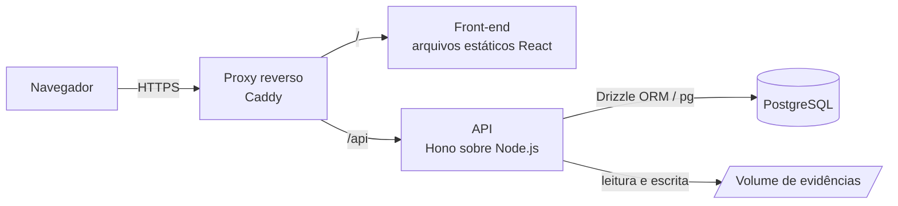

# 04 — Arquitetura e API

## 1. Visão geral

O VulnCase é uma aplicação web em três partes: front-end React, API Hono e banco PostgreSQL. Um *proxy* reverso serve o front-end e a API na mesma origem. Com isso, a autenticação por *cookie* funciona com `SameSite=Strict` e não há configuração de CORS.

A Figura 1 apresenta os contêineres da solução.



*Figura 1 — Diagrama de contêineres.*

## 2. Pilha tecnológica

**Tabela 1 — Tecnologias adotadas**

| Camada | Tecnologia | Uso no projeto |
|---|---|---|
| Linguagem | TypeScript em modo estrito | Front-end, back-end e esquemas compartilhados. |
| *Runtime* | Node.js 24 LTS com `@hono/node-server` | Execução da API. |
| *Framework* HTTP | Hono | Rotas, *middlewares* e cliente RPC tipado. |
| *Middlewares* de segurança | `secureHeaders` e `bodyLimit`, nativos do Hono, e `verificarOrigem`, próprio | RNF10, RNF05 e RNF14. O `csrf` nativo do Hono só verifica corpos de formulário e deixa passar JSON; por isso a verificação de origem é feita por um *middleware* próprio que vale para qualquer tipo de conteúdo. |
| Validação | Zod com `@hono/zod-validator` | Validação de corpo, parâmetros e consulta (RNF07). |
| Persistência | Drizzle ORM com o *driver* `pg` | Consultas tipadas e parametrizadas (RNF08). |
| *Migrations* | `drizzle-kit` | Criação e evolução do esquema (RNF18). |
| *Hash* de senha | Argon2id com `@node-rs/argon2` | RNF01. |
| Sessão | Implementação própria com tabela `sessoes` | RNF04; detalhada na Tabela 4 do documento 03. |
| *Log* | `pino` | *Log* estruturado de autenticação e administração (RNF13). |
| Banco | PostgreSQL 17 | Bloqueio de linha para o contador de códigos. |
| Front-end | React + Vite | Interface. |
| Requisições no front-end | Cliente `hc` do Hono + TanStack Query | Chamadas tipadas a partir das rotas; *cache* e invalidação das listagens. |
| Formulários | React Hook Form + esquemas Zod compartilhados | Validação no cliente para usabilidade; a validação de segurança permanece no back-end. |
| Gráficos do painel | Recharts | Barras por severidade e status. |
| Testes | Vitest e Testcontainers (PostgreSQL) | Testes de domínio sem banco e testes de integração com banco real. |
| Qualidade | ESLint com `eslint-plugin-security` | Regras contra padrões inseguros, como `eval` e expressões regulares vulneráveis. |
| Monorepositório | *Workspaces* do pnpm | Pacotes `backend`, `frontend` e `compartilhado`. |
| Ambiente | Docker Compose e Caddy | Subida com um comando (RNF17) e HTTPS local. |

## 3. Organização do código

O repositório é um monorepositório com três pacotes. O pacote `compartilhado` contém os esquemas Zod e os tipos do domínio usados pelos dois lados. O front-end importa do back-end apenas o tipo `AppType`, que descreve as rotas para o cliente `hc`.

```
vulncase/
├── pnpm-workspace.yaml
├── docker-compose.yml
├── Caddyfile
└── src/
    ├── compartilhado/
    │   └── src/
    │       ├── enums.ts               Severidade, StatusAchado, Papel...
    │       └── esquemas/              esquemas Zod de entrada e saída
    ├── backend/
    │   ├── src/
    │   │   ├── index.ts               inicialização do servidor
    │   │   ├── app.ts                 ordem dos middlewares e montagem das rotas; exporta AppType
    │   │   ├── dominio/
    │   │   │   ├── achado.ts          transicionar(), atribuirResponsavel(), estaVencido()
    │   │   │   ├── regras-transicao.ts  Tabela 7 do documento 03
    │   │   │   ├── projeto.ts         gerarCodigoAchado()
    │   │   │   └── erros.ts           TransicaoInvalidaError, AcessoNegadoError...
    │   │   ├── db/
    │   │   │   ├── schema.ts          tabelas Drizzle
    │   │   │   ├── cliente.ts
    │   │   │   └── seed.ts            dados de demonstração
    │   │   ├── middlewares/
    │   │   │   ├── sessao.ts          valida o cookie e carrega o usuário
    │   │   │   ├── autorizacao.ts     exigirPapel(...)
    │   │   │   └── erros.ts           respostas Problem Details sem detalhes internos
    │   │   ├── rotas/
    │   │   │   ├── auth.ts
    │   │   │   ├── usuarios.ts
    │   │   │   ├── projetos.ts
    │   │   │   ├── achados.ts
    │   │   │   ├── evidencias.ts
    │   │   │   └── painel.ts
    │   │   └── infra/
    │   │       ├── senha.ts           Argon2id
    │   │       ├── armazenamento.ts   gravação e leitura de evidências
    │   │       └── log.ts
    │   ├── drizzle/                   migrations geradas
    │   └── test/
    │       ├── dominio/               transições e regras de negócio
    │       └── integracao/            autorização por rota e fluxo HTTP
    └── frontend/
        ├── src/
        │   ├── api/                   cliente hc e hooks do TanStack Query
        │   ├── auth/                  contexto de sessão e rotas protegidas
        │   ├── paginas/               uma pasta por tela do mapa de telas
        │   └── componentes/           tabela, filtros, selos de severidade e status
        └── vite.config.ts             proxy de /api para a API em desenvolvimento
```

### 3.1 Ordem dos *middlewares*

A Listagem 1 mostra a ordem de aplicação dos *middlewares* em `app.ts`. A ordem garante que cabeçalhos, verificação de origem e limite de tamanho sejam aplicados antes de qualquer leitura de sessão ou de corpo.

```ts
const app = new Hono<Ambiente>()
  .use(registrarRequisicao())
  .use(secureHeaders({ contentSecurityPolicy: csp, xFrameOptions: 'DENY' }))
  .use('/api/*', verificarOrigem(config.origemPermitida))
  .use('/api/*', bodyLimit({ maxSize: 64 * 1024 }))
  .use('/api/*', carregarSessao())
  .route('/api/auth', rotasAuth)
  .route('/api/usuarios', rotasUsuarios)
  .route('/api/projetos', rotasProjetos)
  .route('/api/achados', rotasAchados)
  .route('/api/evidencias', rotasEvidencias)
  .route('/api/painel', rotasPainel)
  .onError(tratarErro)

export type AppType = typeof app
```

*Listagem 1 — Composição da aplicação em `app.ts`.*

O limite de 64 KB vale para corpos JSON. A rota de envio de evidências sobrescreve esse limite com 5 MB (RNF14). O *middleware* `carregarSessao` apenas identifica o usuário; cada rota declara os papéis exigidos com `exigirPapel`, e as regras de propriedade ficam nas funções de domínio.

## 4. Decisões técnicas

| ID | Decisão | Alternativa descartada | Motivo |
|---|---|---|---|
| DT01 | Hono | AdonisJS, NestJS, Elysia | *Framework* mínimo, com *middlewares* de segurança nativos e cliente RPC tipado. Os demais controles são implementados pela equipe e ficam explícitos no código, o que facilita relacioná-los ao modelo de ameaças. O Elysia foi descartado por depender do Bun. |
| DT02 | Sessão em banco com *cookie* `HttpOnly` | JWT em `localStorage` ou JWT sem estado | *Token* em `localStorage` fica acessível a qualquer *script* da página; uma falha de XSS exporia a sessão. JWT sem estado não permite revogar a sessão na saída, na troca de senha ou na desativação. |
| DT03 | Mesma origem para front-end e API | Origens separadas com CORS | Permite `SameSite=Strict` e elimina a configuração de CORS. |
| DT04 | Drizzle ORM | Prisma, SQL manual | Consultas tipadas próximas do SQL, sem motor de consultas separado. SQL manual aumentaria o risco de concatenação. |
| DT05 | Regras de transição em funções puras de domínio | Regras nos *handlers* das rotas | Ponto único de verdade, testável sem HTTP e sem banco. |
| DT06 | Papéis globais | Papéis por projeto | Reduz a modelagem de autorização ao escopo do protótipo (ver itens fora do escopo). |
| DT07 | Exclusão lógica (arquivamento e encerramento) | Exclusão física | Preserva o histórico e a rastreabilidade (RN07, RN08). |
| DT08 | Concorrência otimista com coluna `versao` | Última gravação prevalece | Evita que uma transição sobrescreva outra feita em paralelo. |
| DT09 | Evidências em volume de disco | Evidências no banco (`bytea`) | Mantém o banco pequeno; o volume não é exposto pelo *proxy*. |
| DT10 | Esquemas Zod em pacote compartilhado | Validação duplicada no front-end e no back-end | Uma única definição de regra de entrada para os dois lados. |

## 5. Contrato da API

Todas as rotas ficam sob `/api`, exigem sessão válida (exceto `POST /api/auth/login`) e respondem em JSON. Erros seguem o formato *Problem Details* (RFC 9457), sem pilha de execução. Requisições `POST`, `PUT`, `PATCH` e `DELETE` vindas de origem diferente da configurada são recusadas pelo *middleware* `verificarOrigem` (RNF05).

**Tabela 2 — Rotas da API**

| Método | Rota | Papéis | Descrição | Req. |
|---|---|---|---|---|
| POST | `/api/auth/login` | público | Entrada com e-mail e senha; cria sessão. | RF01 |
| POST | `/api/auth/logout` | todos | Apaga a sessão atual. | RF02 |
| GET | `/api/auth/me` | todos | Dados e papel do usuário atual. | — |
| PUT | `/api/auth/senha` | todos | Troca da própria senha; revoga as demais sessões. | RF05 |
| GET | `/api/usuarios` | Admin | Lista usuários. | RF03 |
| POST | `/api/usuarios` | Admin | Cadastra usuário. | RF03 |
| PATCH | `/api/usuarios/{id}` | Admin | Altera papel ou desativa; desativação revoga sessões. | RF04 |
| GET | `/api/usuarios/responsaveis` | Analista, Admin | Usuários ativos para atribuição. | RF15 |
| GET | `/api/projetos` | todos | Lista projetos com contagens. Filtro `arquivados`. | RF10 |
| POST | `/api/projetos` | Analista, Admin | Cria projeto. | RF07 |
| GET | `/api/projetos/{id}` | todos | Detalhe do projeto. | — |
| PUT | `/api/projetos/{id}` | Analista, Admin | Edita projeto. | RF08 |
| POST | `/api/projetos/{id}/arquivar` | Analista, Admin | Arquiva projeto. | RF09 |
| GET | `/api/projetos/{id}/painel` | todos | Indicadores do projeto. | RF27 |
| GET | `/api/painel` | todos | Indicadores gerais. | RF28 |
| GET | `/api/projetos/{id}/ativos` | todos | (D) Lista ativos. | RF11 |
| POST | `/api/projetos/{id}/ativos` | Analista, Admin | (D) Cadastra ativo. | RF11 |
| GET | `/api/achados` | todos | Lista com filtros e paginação. | RF18 |
| POST | `/api/projetos/{id}/achados` | Analista, Admin | Registra achado. | RF12 |
| GET | `/api/achados/{id}` | todos | Detalhe, com ações permitidas ao usuário. | RF19 |
| PUT | `/api/achados/{id}` | Analista, Admin | Edita campos (achado não encerrado). | RF12, RN05 |
| PUT | `/api/achados/{id}/responsavel` | Analista, Admin | Atribui ou remove responsável. | RF15 |
| POST | `/api/achados/{id}/transicoes` | conforme Tabela 7 do doc. 03 | Altera status. | RF16, RF17 |
| GET | `/api/achados/{id}/historico` | todos | Eventos do achado. | RF20 |
| POST | `/api/achados/{id}/comentarios` | todos (Dev só nos seus) | (D) Comenta. | RF21 |
| POST | `/api/achados/{id}/evidencias` | todos (Dev só nos seus) | (D) Envia evidência (`multipart/form-data`). | RF25 |
| GET | `/api/evidencias/{id}/download` | todos | (D) Baixa evidência. | RF26 |
| DELETE | `/api/evidencias/{id}` | Analista, Admin; autor | (D) Remove evidência. | RF26 |
| GET | `/api/projetos/{id}/relatorio.csv` | todos | (D) Exporta CSV. | RF29 |
| GET | `/api/projetos/{id}/relatorio.pdf` | todos | (D) Gera PDF. | RF30 |
| GET | `/api/categorias-owasp` | todos | Catálogo de categorias. | RF14 |

### 5.1 Exemplos de corpo

Registro de achado (`POST /api/projetos/{id}/achados`):

```json
{
  "titulo": "Credenciais trafegam em texto claro via Telnet",
  "descricao": "O serviço Telnet na porta 23 aceita autenticação sem criptografia.",
  "origem": "AnaliseRede",
  "severidade": "Alta",
  "localizacao": "10.0.0.15:23/tcp",
  "impacto": "Captura de usuário e senha por qualquer nó no mesmo segmento.",
  "passosReproducao": "Capturar tráfego no Wireshark e seguir o fluxo TCP da sessão.",
  "correcaoProposta": "Desativar o Telnet e usar SSH com autenticação por chave.",
  "categoriaOwaspId": 2,
  "cweId": 319,
  "responsavelId": null
}
```

Transição (`POST /api/achados/{id}/transicoes`):

```json
{
  "destino": "FalsoPositivo",
  "justificativa": "O endpoint exige autenticação; a resposta 200 era da página de login.",
  "versao": 4
}
```

Filtros da listagem (`GET /api/achados`): `projetoId`, `status` (repetível), `severidade` (repetível), `responsavelId`, `semResponsavel`, `categoriaOwaspId`, `vencido`, `busca` (título ou código), `ordenarPor` (`severidade`, `criadoEm`, `dataLimite`), `pagina`, `tamanhoPagina` (máximo 100). O campo `ordenarPor` é validado contra essa lista fechada antes de chegar à consulta.

### 5.2 Códigos de resposta

| Código | Situação |
|---|---|
| 200 / 201 / 204 | Sucesso. |
| 400 | Falha de validação, com lista de campos em `errors`. |
| 401 | Sessão ausente, expirada ou revogada. |
| 403 | Papel ou propriedade não autorizados, ou origem não permitida. |
| 404 | Recurso inexistente. |
| 409 | Transição inválida, projeto arquivado ou conflito de versão. |
| 413 | Corpo ou evidência acima do limite. |
| 415 | Tipo de arquivo não permitido. |
| 429 | Conta bloqueada por excesso de tentativas de entrada. |

## 6. Configuração

Variáveis de ambiente lidas pela API e validadas com Zod na inicialização; a API não sobe se alguma estiver ausente ou inválida (RNF12). O repositório contém apenas o arquivo `.env.example`, sem valores reais.

| Variável | Uso |
|---|---|
| `DATABASE_URL` | Conexão com o PostgreSQL. |
| `ORIGEM_PERMITIDA` | Origem aceita pelo *middleware* `csrf` (ex.: `https://localhost`). |
| `EVIDENCIAS_DIRETORIO` | Caminho do volume de evidências. |
| `EVIDENCIAS_TAMANHO_MAXIMO_BYTES` | Padrão `5242880`. |
| `ADMIN_EMAIL_INICIAL`, `ADMIN_SENHA_INICIAL` | Criação do primeiro administrador quando o banco está vazio. |
| `PRAZO_DIAS_CRITICA`, `PRAZO_DIAS_ALTA`, `PRAZO_DIAS_MEDIA`, `PRAZO_DIAS_BAIXA` | Prazos de correção da RN10, em dias. Padrões 7, 30, 90 e 180. |
| `NODE_ENV` | `development` habilita a carga de demonstração e mensagens de erro detalhadas no *log*. |
