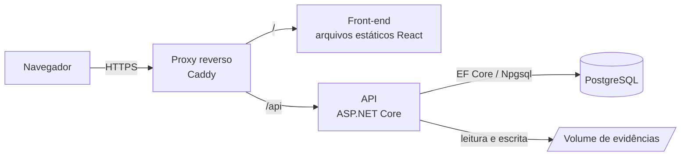

# 04 — Arquitetura e API

## 1. Visão geral

O VulnCase é uma aplicação web em três partes: front-end React, API ASP.NET Core e banco PostgreSQL. O front-end e a API são servidos na mesma origem por meio de um *proxy* reverso, o que permite autenticação por *cookie* com `SameSite=Strict` sem configuração de CORS.

A Figura 1 apresenta os contêineres da solução.



*Figura 1 — Diagrama de contêineres.*

## 2. Pilha tecnológica

**Tabela 1 — Tecnologias adotadas**

| Camada | Tecnologia | Justificativa |
|---|---|---|
| API | ASP.NET Core (.NET 10 LTS) | Versão com suporte de longo prazo vigente. O .NET 8 encerrou o suporte em novembro de 2026. |
| Persistência | Entity Framework Core + Npgsql | Consultas parametrizadas por padrão (RNF08) e *migrations* (RNF18). |
| Autenticação | ASP.NET Core Identity com *cookie* | *Hash* de senha, bloqueio por tentativas e gestão de sessão prontos (RNF01 a RNF04). |
| Validação | FluentValidation | Regras de entrada centralizadas e testáveis (RNF07). |
| Banco | PostgreSQL 17 | Concorrência otimista via `xmin`; bloqueio de linha para o contador de códigos. |
| Front-end | React + TypeScript + Vite | — |
| Requisições no front-end | TanStack Query | Cache e invalidação das listagens após alterações. |
| Formulários | React Hook Form + Zod | Validação no cliente para usabilidade; a validação de segurança permanece no back-end. |
| Gráficos do painel | Recharts | Barras por severidade e status. |
| Testes | xUnit, Testcontainers (PostgreSQL) | Testes de domínio sem banco e testes de integração com banco real. |
| Ambiente | Docker Compose, Caddy | Subida com um comando (RNF17) e HTTPS local. |

## 3. Organização do código

### 3.1 Back-end

O back-end é um único projeto organizado por funcionalidade. A separação em vários projetos (camadas *Domain*, *Application*, *Infrastructure*) foi descartada por acrescentar estrutura sem benefício para o tamanho do protótipo.

```
src/backend/
├── VulnCase.Api/
│   ├── Program.cs                  configuração, cabeçalhos, autenticação
│   ├── Dominio/                    entidades, enums, regras de transição
│   │   ├── Achado.cs
│   │   ├── Projeto.cs
│   │   ├── RegrasTransicao.cs      Tabela 6 do documento 03
│   │   └── Excecoes.cs
│   ├── Dados/
│   │   ├── VulnCaseDbContext.cs
│   │   ├── Configuracoes/          mapeamento EF por entidade
│   │   ├── Migrations/
│   │   └── Seed/                   dados de demonstração
│   ├── Funcionalidades/
│   │   ├── Autenticacao/
│   │   ├── Usuarios/
│   │   ├── Projetos/
│   │   ├── Achados/
│   │   ├── Evidencias/
│   │   └── Painel/
│   └── Infra/
│       ├── TratamentoErros.cs      ProblemDetails sem detalhes internos
│       ├── CabecalhosSeguranca.cs
│       └── ArmazenamentoArquivos.cs
└── VulnCase.Tests/
    ├── Dominio/                    transições e regras de negócio
    └── Integracao/                 autorização por rota e fluxo HTTP
```

### 3.2 Front-end

```
src/frontend/
├── src/
│   ├── api/            cliente HTTP, envio do token CSRF, tipos
│   ├── auth/           contexto de sessão e rotas protegidas
│   ├── paginas/        uma pasta por tela do mapa de telas
│   ├── componentes/    tabela, filtros, selos de severidade e status
│   └── utils/
└── vite.config.ts      proxy de /api para a API em desenvolvimento
```

## 4. Decisões técnicas

| ID | Decisão | Alternativa descartada | Motivo |
|---|---|---|---|
| DT01 | Sessão por *cookie* `HttpOnly` | JWT em `localStorage` | *Token* em `localStorage` fica acessível a qualquer *script* da página; uma falha de XSS exporia a sessão. |
| DT02 | Mesma origem para front-end e API | Origens separadas com CORS | Permite `SameSite=Strict` e elimina a configuração de CORS. |
| DT03 | Regras de transição na entidade `Achado` | Regras nos *controllers* | Ponto único de verdade, testável sem HTTP. |
| DT04 | Papéis globais | Papéis por projeto | Reduz a modelagem de autorização ao escopo do protótipo (ver itens fora do escopo). |
| DT05 | Exclusão lógica (arquivamento e encerramento) | Exclusão física | Preserva o histórico e a rastreabilidade (RN07, RN08). |
| DT06 | Concorrência otimista com `xmin` | Última gravação prevalece | Evita que uma transição sobrescreva outra feita em paralelo. |
| DT07 | Evidências em volume de disco | Evidências no banco (`bytea`) | Mantém o banco pequeno; o volume não é exposto pelo *proxy*. |

## 5. Contrato da API

Todas as rotas ficam sob `/api`, exigem autenticação (exceto `POST /api/auth/login`) e respondem em JSON. Erros seguem o formato *Problem Details* (RFC 9457), sem pilha de execução. Requisições `POST`, `PUT`, `PATCH` e `DELETE` exigem o cabeçalho `X-CSRF-TOKEN`, obtido em `GET /api/auth/csrf`.

**Tabela 2 — Rotas da API**

| Método | Rota | Papéis | Descrição | Req. |
|---|---|---|---|---|
| GET | `/api/auth/csrf` | público | Emite o *token* antifalsificação. | RNF05 |
| POST | `/api/auth/login` | público | Entrada com e-mail e senha. | RF01 |
| POST | `/api/auth/logout` | todos | Encerra a sessão. | RF02 |
| GET | `/api/auth/me` | todos | Dados e papel do usuário atual. | — |
| PUT | `/api/auth/senha` | todos | Troca da própria senha. | RF05 |
| GET | `/api/usuarios` | Admin | Lista usuários. | RF03 |
| POST | `/api/usuarios` | Admin | Cadastra usuário. | RF03 |
| PATCH | `/api/usuarios/{id}` | Admin | Altera papel ou desativa. | RF04 |
| GET | `/api/usuarios/responsaveis` | Analista, Admin | Usuários ativos para atribuição. | RF15 |
| GET | `/api/projetos` | todos | Lista projetos com contagens. Filtro `arquivados`. | RF10 |
| POST | `/api/projetos` | Analista, Admin | Cria projeto. | RF07 |
| GET | `/api/projetos/{id}` | todos | Detalhe do projeto. | — |
| PUT | `/api/projetos/{id}` | Analista, Admin | Edita projeto. | RF08 |
| POST | `/api/projetos/{id}/arquivar` | Analista, Admin | Arquiva projeto. | RF09 |
| GET | `/api/projetos/{id}/painel` | todos | Indicadores do projeto. | RF27 |
| GET | `/api/painel` | todos | Indicadores gerais. | RF28 |
| GET | `/api/projetos/{id}/ativos` | todos | (D) Lista ativos. | RF11 |
| POST | `/api/projetos/{id}/ativos` | Analista, Admin | (D) Cadastra ativo. | RF11 |
| GET | `/api/achados` | todos | Lista com filtros e paginação. | RF18 |
| POST | `/api/projetos/{id}/achados` | Analista, Admin | Registra achado. | RF12 |
| GET | `/api/achados/{id}` | todos | Detalhe, com ações permitidas ao usuário. | RF19 |
| PUT | `/api/achados/{id}` | Analista, Admin | Edita campos (achado não encerrado). | RF12, RN05 |
| PUT | `/api/achados/{id}/responsavel` | Analista, Admin | Atribui ou remove responsável. | RF15 |
| POST | `/api/achados/{id}/transicoes` | conforme Tabela 6 do doc. 03 | Altera status. | RF16, RF17 |
| GET | `/api/achados/{id}/historico` | todos | Eventos do achado. | RF20 |
| POST | `/api/achados/{id}/comentarios` | todos (Dev só nos seus) | (D) Comenta. | RF21 |
| POST | `/api/achados/{id}/evidencias` | todos (Dev só nos seus) | (D) Envia evidência. | RF25 |
| GET | `/api/evidencias/{id}/download` | todos | (D) Baixa evidência. | RF26 |
| DELETE | `/api/evidencias/{id}` | Analista, Admin; autor | (D) Remove evidência. | RF26 |
| GET | `/api/projetos/{id}/relatorio.csv` | todos | (D) Exporta CSV. | RF29 |
| GET | `/api/projetos/{id}/relatorio.pdf` | todos | (D) Gera PDF. | RF30 |
| GET | `/api/categorias-owasp` | todos | Catálogo de categorias. | RF14 |

### 5.1 Exemplos de corpo

Registro de achado (`POST /api/projetos/{id}/achados`):

```json
{
  "titulo": "Credenciais trafegam em texto claro via Telnet",
  "descricao": "O serviço Telnet na porta 23 aceita autenticação sem criptografia.",
  "origem": "AnaliseRede",
  "severidade": "Alta",
  "localizacao": "10.0.0.15:23/tcp",
  "impacto": "Captura de usuário e senha por qualquer nó no mesmo segmento.",
  "passosReproducao": "Capturar tráfego no Wireshark e seguir o fluxo TCP da sessão.",
  "correcaoProposta": "Desativar o Telnet e usar SSH com autenticação por chave.",
  "categoriaOwaspId": 2,
  "cweId": 319,
  "responsavelId": null
}
```

Transição (`POST /api/achados/{id}/transicoes`):

```json
{
  "destino": "FalsoPositivo",
  "justificativa": "O endpoint exige autenticação; a resposta 200 era da página de login.",
  "versao": 48213
}
```

Filtros da listagem (`GET /api/achados`): `projetoId`, `status` (repetível), `severidade` (repetível), `responsavelId`, `semResponsavel`, `categoriaOwaspId`, `vencido`, `busca` (título ou código), `ordenarPor` (`severidade`, `criadoEm`, `dataLimite`), `pagina`, `tamanhoPagina` (máximo 100).

### 5.2 Códigos de resposta

| Código | Situação |
|---|---|
| 200 / 201 / 204 | Sucesso. |
| 400 | Falha de validação, com lista de campos em `errors`. |
| 401 | Sessão ausente ou expirada. |
| 403 | Papel ou propriedade não autorizados, ou *token* CSRF inválido. |
| 404 | Recurso inexistente. |
| 409 | Transição inválida, projeto arquivado ou conflito de versão. |
| 413 | Evidência acima do limite. |
| 415 | Tipo de arquivo não permitido. |
| 429 | Excesso de tentativas de entrada. |

## 6. Configuração

Variáveis de ambiente lidas pela API (RNF12). O repositório contém apenas o arquivo `.env.example`, sem valores reais.

| Variável | Uso |
|---|---|
| `ConnectionStrings__Banco` | Conexão com o PostgreSQL. |
| `Evidencias__Diretorio` | Caminho do volume de evidências. |
| `Evidencias__TamanhoMaximoBytes` | Padrão `5242880`. |
| `Admin__EmailInicial`, `Admin__SenhaInicial` | Criação do primeiro administrador quando o banco está vazio. |
| `ASPNETCORE_ENVIRONMENT` | `Development` habilita OpenAPI e a carga de demonstração. |
