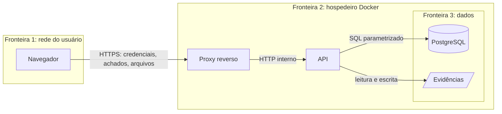

# 05 — Modelo de ameaças

Este documento aplica o método STRIDE (*Spoofing*, *Tampering*, *Repudiation*, *Information disclosure*, *Denial of service*, *Elevation of privilege*) à própria ferramenta. O VulnCase armazena detalhes de exploração de vulnerabilidades ainda não corrigidas; um vazamento desses dados entrega a um atacante uma lista priorizada de alvos.

## 1. Ativos protegidos

| Ativo | Por que importa |
|---|---|
| Descrição, passos de reprodução e evidências dos achados abertos | Permitem explorar sistemas ainda vulneráveis. |
| Credenciais e sessões de usuários | Dão acesso a todos os achados. |
| Histórico de eventos | Comprova quem verificou e encerrou cada achado. |
| Disponibilidade da ferramenta | Necessária para acompanhar correções. |

## 2. Fronteiras de confiança

A Figura 1 apresenta o diagrama de fluxo de dados com as fronteiras de confiança (linhas tracejadas).

*Figura 1 — Diagrama de fluxo de dados.*

## 3. Ameaças e controles

**Tabela 1 — Análise STRIDE**

| ID | Categoria | Ameaça | Controle | Requisito |
|---|---|---|---|---|
| A01 | *Spoofing* | Força bruta ou reutilização de senha no formulário de entrada. | Senha mínima de 10 caracteres; bloqueio após 5 falhas por 15 min; resposta genérica para usuário inexistente e senha errada. | RNF02, RNF03 |
| A02 | *Spoofing* | Roubo de sessão por XSS. | *Cookie* `HttpOnly`; CSP sem `unsafe-inline` para *scripts*; renderização de texto sem HTML. | RNF04, RNF09, RNF10 |
| A03 | *Tampering* | CSRF: página externa dispara transição de status com a sessão da vítima. | `SameSite=Strict` e *token* antifalsificação em métodos que alteram estado. | RNF04, RNF05 |
| A04 | *Tampering* | SQL Injection nos filtros da listagem. | EF Core com parâmetros; filtros de enumeração validados contra valores permitidos; ordenação por lista fechada de campos. | RNF07, RNF08 |
| A05 | *Tampering* | Evidência maliciosa (HTML ou SVG com *script*, executável renomeado). | Lista de extensões permitidas; verificação de assinatura do arquivo; nome gerado pelo servidor; *download* com `attachment` e `nosniff`. | RNF14, RNF15 |
| A06 | *Tampering* | Duas transições simultâneas no mesmo achado, uma sobrescrevendo a outra. | Concorrência otimista por `xmin`. | DT06 |
| A07 | *Repudiation* | Usuário nega ter encerrado ou aceitado o risco de um achado. | Histórico somente de inserção, com autor, data e justificativa. | RF20, RF17 |
| A08 | *Repudiation* | Ação administrativa sem rastro (criação de usuário, troca de papel). | Log estruturado de eventos de autenticação e administração. | RNF13 |
| A09 | *Information disclosure* | Desenvolvedor acessa rota de outro papel chamando a API diretamente. | Autorização no back-end em todas as rotas; testes de integração por rota e papel. | RNF06, RNF20 |
| A10 | *Information disclosure* | Referência direta insegura a objeto (IDOR): acesso a evidência pelo identificador. | Identificadores UUID; verificação de autorização no *download*, não apenas na listagem. | RNF06 |
| A11 | *Information disclosure* | Mensagens de erro revelam SQL ou caminhos internos. | *Problem Details* genérico em produção; detalhes apenas no log do servidor. | RNF11 |
| A12 | *Information disclosure* | Segredos versionados no repositório. | Variáveis de ambiente; `.env` no `.gitignore`; verificação com `gitleaks` antes de cada entrega. | RNF12 |
| A13 | *Information disclosure* | Dependência com vulnerabilidade conhecida. | `dotnet list package --vulnerable` e `npm audit` antes de cada entrega. | RNF16 |
| A14 | *Denial of service* | Envio de arquivos grandes esgota disco. | Limite de 5 MB por arquivo, aplicado também no *proxy*. | RNF14 |
| A15 | *Denial of service* | Listagem sem limite de página sobrecarrega a API. | Tamanho de página máximo de 100. | RF18 |
| A16 | *Elevation of privilege* | *Mass assignment*: cliente envia `status`, `papel` ou `registradoPorId` no corpo da edição. | DTOs de entrada com apenas os campos editáveis; status só muda pela rota de transição. | RNF07 |
| A17 | *Elevation of privilege* | Desenvolvedor conclui correção de achado atribuído a outra pessoa. | Verificação de propriedade em `Achado.Transicionar`. | RN04 |

## 4. Riscos aceitos no protótipo

| Risco | Motivo da aceitação |
|---|---|
| Ausência de autenticação multifator | Fora do escopo; mitigado parcialmente por A01. |
| Administrador com acesso irrestrito | Premissa de confiança nos administradores (documento 01, seção 9). |
| Evidências sem cifragem em repouso | O volume fica no hospedeiro da equipe; a cifragem de disco fica a cargo do sistema operacional. |
| Ausência de antivírus no envio de arquivos | Mitigado pela lista de tipos permitidos e pelo *download* como anexo. |

## 5. Verificação

Antes da apresentação final, a equipe executa sobre o próprio VulnCase os testes abaixo e registra os resultados como achados de um projeto chamado "VulnCase" na própria ferramenta:

1. tentativa de XSS armazenado nos campos de texto do achado;
2. tentativa de SQL Injection nos parâmetros de filtro;
3. chamada direta às rotas de Analista e Administrador com sessão de Desenvolvedor;
4. envio de arquivo `.html` renomeado para `.png`;
5. requisição de alteração sem *token* CSRF;
6. verificação dos cabeçalhos de segurança com o OWASP ZAP em modo passivo.
