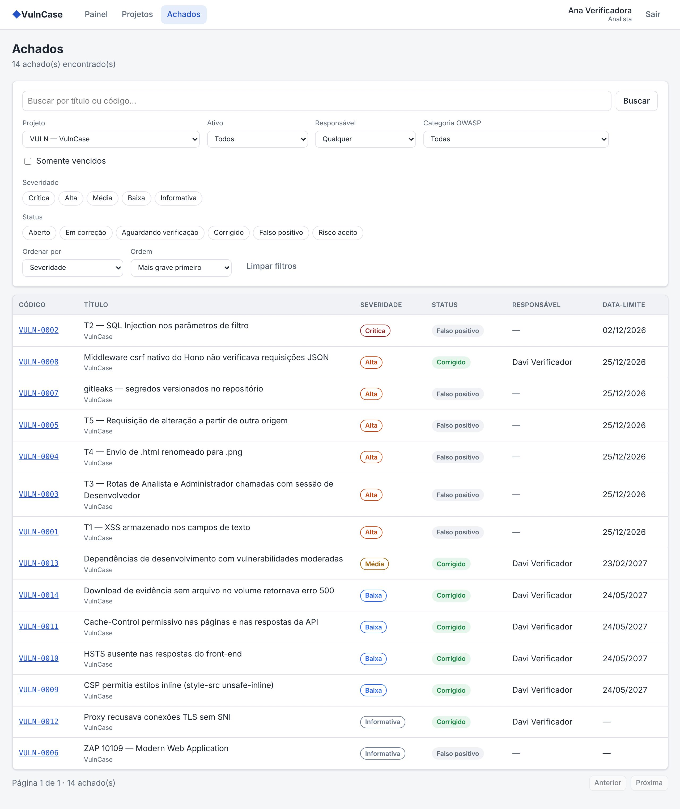

# 08 — Verificação de segurança da própria ferramenta

Execução dos testes da [seção 5 do documento 05](05-modelo-de-ameacas.md#5-verificação) sobre o VulnCase, com os resultados registrados como achados do projeto **VulnCase** (prefixo `VULN`) na própria ferramenta.

| Item | Valor |
|---|---|
| Data | 25/11/2026 |
| Ambiente | `docker compose down -v && docker compose up` com as imagens da branch `test/36-verificacao-seguranca`, acesso por `https://localhost` |
| Execução | [`scripts/verificacao-seguranca.cjs`](../scripts/verificacao-seguranca.cjs) (testes 1 a 5), OWASP ZAP *baseline* (teste 6), `pnpm audit` e `gitleaks` |
| Registro | [`scripts/registrar-verificacao.cjs`](../scripts/registrar-verificacao.cjs) cria o projeto `VULN` e um achado por teste ou problema |
| Resultado | 5 de 5 testes aprovados; ZAP com 0 falhas e 1 alerta informativo; `pnpm audit` e `gitleaks` sem pendências. Sete problemas encontrados durante a implementação e a verificação foram corrigidos e verificados. |

## 1. Testes do documento 05

| # | Teste | Resultado | Evidência |
|:-:|---|:-:|---|
| T1 | XSS armazenado nos campos de texto | Aprovado | Cargas em título, descrição, impacto, passos, correção, localização, comentário, nome e descrição do projeto e ativo: 5 variações.<br>Páginas visitadas: /, /projetos, /projetos/78799de7-0486-4efd-9a82-767cb860e083, /achados?projetoId=78799de7-0486-4efd-9a82-767cb860e083, /achados/6cb66017-39f3-4b8e-ad0e-41e994bc2004, /achados/6cb66017-39f3-4b8e-ad0e-41e994bc2004/editar.<br>Diálogos JavaScript disparados: 0; elementos injetados: nenhum.<br>Título exibido literalmente: "<script>alert('xss-script')</script>".<br>CSP da aplicação: default-src 'self'; script-src 'self'; style-src 'self'; img-src 'self' data:; connect-src 'self'; font-src 'self'; object-src 'none'; base-uri 'self'; form-action 'self'; frame-ancestors 'none'. |
| T2 | SQL Injection nos parâmetros de filtro | Aprovado | busca (texto livre, 6 cargas, incluindo pg_sleep(5)): 200/total 0/11 ms; 200/total 0/9 ms; 200/total 0/6 ms; 200/total 0/7 ms; 200/total 0/7 ms; 200/total 0/8 ms.<br>Parâmetros tipados (11 cargas): projetoId=400, status=400, severidade=400, ordenarPor=400, ordenarPor=400, ordem=400, categoriaOwaspId=400, tamanhoPagina=400, pagina=400, vencido=400, responsavelId=400.<br>Total de achados antes e depois: 1 e 1. |
| T3 | Rotas de Analista e Administrador chamadas com sessão de Desenvolvedor | Aprovado | GET /api/usuarios → 403<br>POST /api/usuarios → 403<br>PATCH /api/usuarios/{id} → 403<br>PATCH /api/usuarios/{id} → 403<br>GET /api/usuarios/responsaveis → 403<br>POST /api/projetos → 403<br>PUT /api/projetos/{id} → 403<br>POST /api/projetos/{id}/arquivar → 403<br>POST /api/projetos/{id}/ativos → 403<br>POST /api/projetos/{id}/achados → 403<br>PUT /api/achados/{id} → 403<br>PUT /api/achados/{id}/responsavel → 403<br>POST /api/achados/{id}/transicoes → 403<br>POST /api/achados/{id}/transicoes → 403<br>POST /api/achados/{id}/transicoes → 403<br>POST /api/achados/{id}/transicoes → 403<br>POST /api/achados/{id}/comentarios → 403<br>Administradores após o teste: 1. |
| T4 | Envio de .html renomeado para .png | Aprovado | pagina.png → 415<br>vetor.png → 415<br>programa.pdf → 415<br>pagina.html → 415<br>imagem.svg → 415<br>captura.png.html → 415<br>Evidências gravadas: 0. |
| T5 | Requisição de alteração a partir de outra origem | Aprovado | POST /api/projetos com Origin https://atacante.example e sessão de administrador → 403.<br>POST /api/projetos sem Origin nem Sec-Fetch-Site → 403.<br>Página em https://atacante.example com fetch JSON (credentials: include) → bloqueado pelo navegador; formulário text/plain autoenviado → respostas da API: 403.<br>Projetos criados pelas tentativas: 0 (antes 2, depois 2). |

Resultados completos em [`verificacao/resultados.json`](verificacao/resultados.json).

## 2. OWASP ZAP em modo passivo

Comando: `docker run --network host -v $PWD/zap:/zap/wrk zaproxy/zap-stable zap-baseline.py -t https://localhost -r zap.html -J zap.json -I -m 3`.

| Execução | Falhas | Alertas | Aprovadas |
|---|:-:|:-:|:-:|
| Primeira | 0 | 4 — Cache-control (10015), HSTS ausente (10035), CSP `style-src 'unsafe-inline'` (10055), Modern Web Application (10109) | 58 |
| Após as correções | 0 | 1 — Modern Web Application (10109), informativo | 61 |

Relatório final: [`verificacao/zap-baseline.html`](verificacao/zap-baseline.html) ([JSON](verificacao/zap-baseline.json)).

A primeira tentativa falhou no *handshake* TLS: o cliente Java do ZAP não envia SNI para `localhost`. A correção (`default_sni` no Caddy) está registrada como `VULN-0012`.

## 3. Dependências e segredos

| Verificação | Resultado |
|---|---|
| `pnpm audit --prod` | Nenhuma vulnerabilidade conhecida. |
| `pnpm audit` (com desenvolvimento) | Inicialmente 3 moderadas em dependências transitivas de `drizzle-kit` e `testcontainers`; corrigidas com `overrides` no `pnpm-workspace.yaml` (`VULN-0013`). Após a correção: nenhuma. |
| `gitleaks` 8.28 (histórico e diretório) | Nenhum segredo encontrado. |

## 4. Achados registrados no projeto VulnCase

| Código | Achado | Severidade | Situação |
|---|---|---|---|
| VULN-0001 | T1 — XSS armazenado nos campos de texto | Alta | Falso positivo (controle efetivo) |
| VULN-0002 | T2 — SQL Injection nos parâmetros de filtro | Crítica | Falso positivo (controle efetivo) |
| VULN-0003 | T3 — Rotas de Analista e Administrador com sessão de Desenvolvedor | Alta | Falso positivo (controle efetivo) |
| VULN-0004 | T4 — Envio de .html renomeado para .png | Alta | Falso positivo (controle efetivo) |
| VULN-0005 | T5 — Requisição de alteração a partir de outra origem | Alta | Falso positivo (controle efetivo) |
| VULN-0006 | ZAP 10109 — Modern Web Application | Informativa | Falso positivo (alerta informativo) |
| VULN-0007 | gitleaks — segredos versionados | Alta | Falso positivo (nada encontrado) |
| VULN-0008 | Middleware `csrf` nativo do Hono não verificava requisições JSON | Alta | Corrigido |
| VULN-0009 | CSP permitia estilos inline | Baixa | Corrigido |
| VULN-0010 | HSTS ausente nas respostas do front-end | Baixa | Corrigido |
| VULN-0011 | Cache-Control permissivo nas páginas e na API | Baixa | Corrigido |
| VULN-0012 | Proxy recusava conexões TLS sem SNI | Informativa | Corrigido |
| VULN-0013 | Dependências de desenvolvimento com vulnerabilidades moderadas | Média | Corrigido |
| VULN-0014 | Download de evidência sem arquivo retornava erro 500 | Baixa | Corrigido |

Os testes sem vulnerabilidade foram encerrados como "Falso positivo" porque a suspeita testada não se confirmou; a justificativa de cada um descreve o controle verificado. Os problemas reais seguiram o fluxo completo (atribuição, correção, verificação e encerramento), com o histórico preservado na ferramenta. Nenhum risco precisou ser aceito.



## 5. Como repetir

```bash
docker compose down -v && docker compose up -d --build
pnpm verificacao        # testes 1 a 5 → docs/verificacao/resultados.json
pnpm verificacao:registrar
docker run --rm --network host -v "$PWD/docs/verificacao:/zap/wrk" zaproxy/zap-stable \
  zap-baseline.py -t https://localhost -r zap-baseline.html -J zap-baseline.json -I
pnpm audit
```
